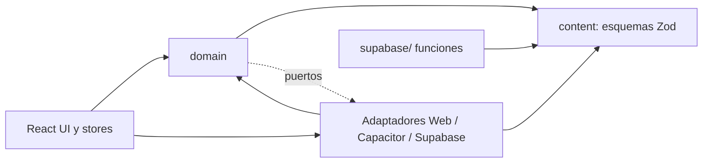
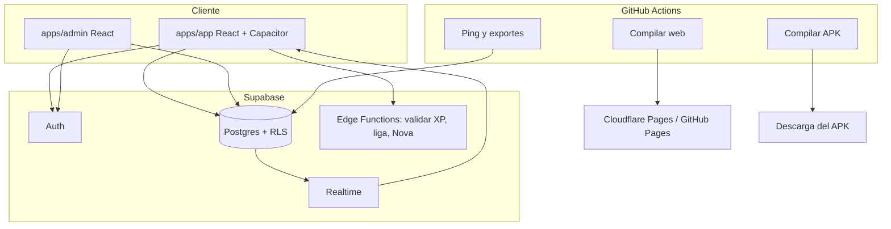
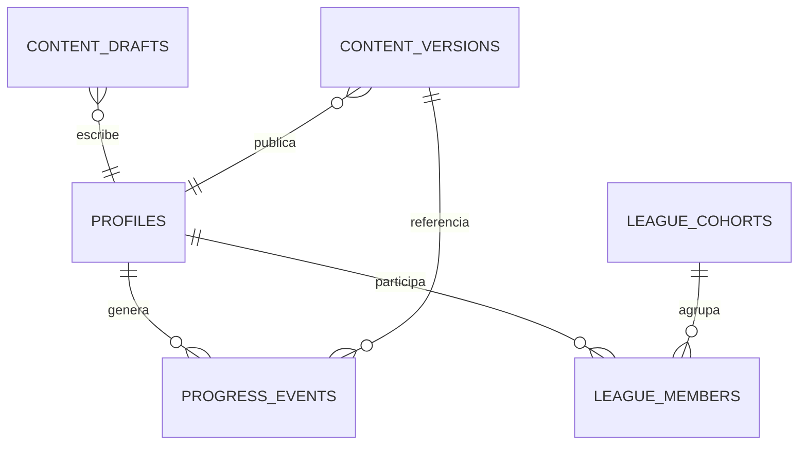

# Architecture Spine — LinguaPop Plataforma

## Design Paradigm

**Hexagonal (puertos y adaptadores)**. El dominio es TypeScript puro: no importa React, DOM, Capacitor ni Supabase. Habla con el mundo solo mediante puertos (interfaces). Las apps conectan adaptadores concretos en una raíz de composición, una por plataforma.

| Capa | Ubicación | Puede depender de |
| --- | --- | --- |
| Dominio | `packages/domain` | `packages/content` (solo tipos y esquemas) |
| Contenido (esquemas) | `packages/content` | nada del repo |
| Adaptadores y UI | `apps/app`, `apps/admin` | `domain`, `content` |
| Backend | `supabase/` | `content` (esquemas compartidos en funciones) |

## Invariants & Rules



La flecha de dependencia nunca apunta hacia `apps/`. `domain` nunca importa de `apps/` ni de ningún SDK de plataforma.

### AD-1 — Dominio puro y puertos [ADOPTED]

- **Binds:** `packages/domain`, toda la lógica de juego.
- **Prevents:** reglas de juego duplicadas por plataforma o acopladas a React o a un proveedor.
- **Rule:** `packages/domain` no importa `react`, `window`, `document`, `@capacitor/*`, `@supabase/*` ni `apps/*`. Toda capacidad externa entra por un puerto declarado en `packages/domain/src/ports`. Una regla ESLint de restricción de imports lo hace cumplir en CI.

### AD-2 — Fronteras del monorepo [ADOPTED]

- **Binds:** estructura de `pnpm` workspaces.
- **Prevents:** que `apps/admin` importe de `apps/app` (o al revés) y arrastre código ajeno.
- **Rule:** `apps/*` no se importan entre sí. El código compartido vive solo en `packages/*`. Cada paquete expone una entrada pública (`index.ts`); no se importa por rutas internas.

### AD-3 — El contenido es dato validado, con un solo esquema

- **Binds:** unidades, lecciones, ejercicios, diálogos de Nova, logros.
- **Prevents:** que app, panel y servidor acepten formas distintas de un mismo ejercicio.
- **Rule:** `packages/content` define con Zod la unión discriminada por `type` (`mc`, `order`, `write`, `match`, `listen`, `speak`, `dialogue`). La app, el panel de administración y las funciones del servidor validan con ese mismo esquema. Un ejercicio que no valide no se guarda, no se publica y no se muestra. Las lecciones son listas ordenadas de ids de ejercicio dentro del snapshot; el dominio solo muestrea en modos de práctica (repaso, personalizada, desafío, prueba de nivel). Las condiciones de logro son una enumeración cerrada implementada en el dominio; el esquema rechaza condiciones desconocidas. El esquema evoluciona solo de forma aditiva (campos opcionales nuevos, tipos nuevos); un cambio incompatible sube `schema_version`.

### AD-4 — Publicar es crear una versión inmutable

- **Binds:** tablas de contenido, panel de administración, descarga de contenido en la app.
- **Prevents:** que un estudiante vea contenido a medio editar o que una edición reescriba el pasado.
- **Rule:** los autores escriben en borradores. Publicar crea una fila de snapshot completo e inmutable (`content_versions`, JSON validado) con número ascendente y un único puntero `latest`. Los estudiantes leen solo snapshots publicados. Volver atrás es mover el puntero. Todo evento de progreso lleva el `content_version` con el que se generó. Un id de ejercicio nunca se reutiliza ni desaparece: un ejercicio retirado se marca `retired` y sigue resolviendo en versiones históricas.

### AD-5 — Contenido offline: semilla más caché

- **Binds:** adaptador de contenido en `apps/app`.
- **Prevents:** una app inutilizable sin red o en el primer arranque.
- **Rule:** el paquete de la app incluye un snapshot semilla. Al abrir, la app usa el último snapshot guardado localmente y consulta el puntero `latest` con revalidación; descarga y guarda uno nuevo si cambió. Nunca bloquea la interfaz esperando red. Cada snapshot declara su `schema_version` y el puntero `latest` existe por cada `schema_version`; la app lee solo el de su versión. El lector es tolerante: un ejercicio de tipo desconocido se omite y se registra, sin descartar el snapshot. Un snapshot que no valide contra el esquema se descarta y se conserva el anterior.

### AD-6 — El progreso son eventos idempotentes, local-primero [ADOPTED]

- **Binds:** XP, lecciones completadas, errores, racha, llamadas a Nova.
- **Prevents:** pisar datos entre dispositivos y duplicar XP al reintentar envíos.
- **Rule:** todo cambio de progreso es un evento append-only con `id` UUID generado en el cliente, `type`, `payload` versionado, `occurred_at` y `content_version`. La app aplica el evento localmente al instante y lo encola en un outbox; se envía a Supabase cuando hay red. El servidor ignora ids repetidos. El estado local se reconstruye siempre plegando eventos con funciones puras del dominio. La racha y el protector mensual se derivan siempre de ese pliegue; no existe un evento de consumo del protector. El `user_id` nunca viaja en el payload: lo asigna el servidor desde la sesión. El servidor acepta la versión de payload actual y la anterior; un cliente ignora al plegar los tipos de evento que no conoce. [ASSUMPTION] Se permite usar la app como invitado con eventos solo locales; al iniciar sesión se suben bajo la cuenta.

### AD-7 — El servidor deriva los agregados; el cliente nunca escribe totales [ADOPTED]

- **Binds:** XP semanal, liga, ranking, logros.
- **Prevents:** totales falsificados y ligas que dependen de lo que diga cada cliente.
- **Rule:** el cliente solo inserta eventos. XP semanal, cohortes y posiciones se calculan en el servidor a partir de los eventos. Una función o disparador valida un tope de XP por evento y por día antes de aceptar; un evento fuera de tope se rechaza y registra, y el cliente lo marca `rejected` y lo excluye del pliegue. El cliente nunca calcula la semana de liga ni las posiciones: muestra lo que devuelve el servidor (puede mostrar XP optimista que se reconcilia). La liga forma cohortes semanales de hasta 30; si hay menos personas reales, se completan con bots generados en el servidor y marcados con `is_bot = true`, y la interfaz los muestra como bots.

### AD-8 — Identidad, roles y permisos en la base de datos

- **Binds:** Supabase Auth, tabla `profiles`, políticas de seguridad por fila (RLS).
- **Prevents:** controles de permisos que solo viven en la interfaz.
- **Rule:** el login es por correo y contraseña y por Google. El rol (`student`, `author`, `publisher`) vive en `profiles.role` y lo hacen cumplir las políticas RLS: un estudiante lee solo su propio progreso y los snapshots publicados; un autor escribe borradores; solo un publicador publica. Ningún cliente usa la clave de servicio. La única ruta de lectura entre usuarios es una vista o función de liga que expone nombre visible y XP semanal; nunca correo ni eventos de otros. Realtime solo publica esa vista. Cada usuario puede solicitar el borrado de su cuenta y datos.

### AD-9 — Sin secretos en ningún cliente

- **Binds:** bundles web y APK, funciones del servidor.
- **Prevents:** claves de API extraíbles del navegador o del APK.
- **Rule:** los bundles contienen únicamente la URL de Supabase y la clave anónima pública. Cualquier llamada a un modelo de lenguaje (Nova libre) pasa por una Edge Function que guarda la clave en secretos de Supabase y aplica límite por usuario. Los keystores y claves de firma viven solo en secretos de GitHub Actions.

### AD-10 — Capacidades de plataforma detrás de puertos

- **Binds:** voz, sonido, reloj, almacenamiento, contenido, progreso, diálogo.
- **Prevents:** código que pregunta por la plataforma (`if (window.…)`) disperso en el dominio y la UI.
- **Rule:** los puertos mínimos son `Speech` (síntesis y reconocimiento), `Sound`, `Clock`, `LocalStore`, `ContentSource`, `ProgressSink` y `DialogueAgent`. Cada app elige sus adaptadores en una única raíz de composición (`apps/app/src/composition`). Los adaptadores se prueban contra un conjunto de pruebas de contrato compartido.

### AD-11 — La voz degrada, nunca bloquea

- **Binds:** adaptadores `Speech`, ejercicios `listen` y `speak`, llamadas con Nova.
- **Prevents:** lecciones atascadas cuando no hay micrófono, reconocimiento o voces.
- **Rule:** el puerto `Speech` expone sus capacidades (`canSpeak`, `canListen`). Si falta el reconocimiento, el ejercicio ofrece escritura y "Omitir"; si falta la síntesis, muestra el texto. Toda ruta de ejercicio tiene una salida sin voz. No se usan endpoints no oficiales de terceros para voz; en Android se usan los plugins nativos de Capacitor y en la web la Web Speech API.

### AD-12 — Los motores son máquinas de estado puras; la UI solo guarda estado de pantalla

- **Binds:** sesión de lección, llamada con Nova, comparación de texto.
- **Prevents:** reglas de juego dentro de componentes y estado compartido ambiguo.
- **Rule:** el motor de lección y el de llamada son funciones puras `(estado, evento) → (estado, efectos)` en `packages/domain`. Los efectos (hablar, sonar, guardar) los ejecutan adaptadores. Los stores de Zustand en `apps/*` guardan solo estado de interfaz y el estado del motor; ningún componente contiene reglas de puntuación, racha o comparación.

### AD-13 — El tiempo y los días pasan por el puerto Clock

- **Binds:** racha, meta diaria, ligas semanales, protector mensual.
- **Prevents:** rachas distintas según dispositivo o zona horaria y pruebas no reproducibles.
- **Rule:** nada llama a `Date.now()` ni `new Date()` fuera del adaptador `Clock`. El límite del día usa la zona horaria IANA guardada en `profiles.timezone`. La semana de liga empieza en lunes a las 00:00 UTC en el servidor.

### AD-14 — Entrega reproducible por CI, migraciones en el repositorio

- **Binds:** `.github/workflows`, `supabase/migrations`.
- **Prevents:** compilaciones manuales irrepetibles y bases de datos cambiadas a mano.
- **Rule:** GitHub Actions compila la web, el APK de depuración y el APK firmado de versión (desde una etiqueta git). Todo cambio de esquema es una migración versionada en `supabase/migrations`, aplicada con la CLI de Supabase; no se edita el esquema desde el panel. Un flujo programado hace una consulta periódica para evitar la pausa del plan gratis y otro exporta la base de datos de forma regular; todo exporte se cifra antes de subirse como artefacto, de modo que el repositorio pueda ser público sin exponer datos.

### AD-15 — Migración estrangulada y progreso heredado

- **Binds:** `linguapop.html`, datos de `localStorage` existentes, contenido semilla.
- **Prevents:** perder contenido o progreso al migrar y una reescritura sin referencia.
- **Rule:** `linguapop.html` se conserva funcional hasta alcanzar paridad. El contenido de `UNITS`, `TOPICS` y `ACHIEVEMENTS` se extrae una sola vez a JSON validado por `packages/content` (la semilla). El progreso del `localStorage` heredado se importa como eventos sintéticos marcados `source = legacy` al primer inicio de sesión.

### AD-16 — Puertas de calidad en CI

- **Binds:** todos los paquetes.
- **Prevents:** regresiones silenciosas en reglas de juego y contenido inválido llegando a producción.
- **Rule:** CI exige: pruebas unitarias de `packages/domain` (Vitest) con los casos de comparación de texto, racha y puntuación; validación Zod de todo el contenido semilla; la regla de imports de AD-1 y AD-2; y compilación de la web y del APK. Una pull request no se fusiona si falla alguna.

## Consistency Conventions

| Concern | Convention |
| --- | --- |
| Naming | Archivos en `kebab-case`; tipos y componentes en `PascalCase`; puertos con sufijo `Port`; adaptadores con prefijo de plataforma (`WebSpeechAdapter`, `CapacitorSpeechAdapter`, `SupabaseProgressSink`). |
| Ids | UUID v4 generados en el cliente para eventos; ids de contenido estables tipo `slug` (por ejemplo `u-saludos`, `u-saludos-e07`) y nunca reutilizados. |
| Fechas | `occurred_at` en ISO 8601 UTC; el día local se deriva con `profiles.timezone`. |
| Errores | Resultados tipados `ok`/`error` en el dominio; excepciones solo en adaptadores y se capturan en la frontera. |
| Eventos | `type` en `snake_case` con versión de payload (`lesson_completed@1`); un cambio de forma sube la versión, no la edita. |
| Configuración | Variables `VITE_*` solo públicas; secretos solo en Supabase o GitHub. |
| Idioma | Textos de interfaz en español desde un catálogo de claves, no en línea; el contenido declara su par de idiomas (`es` → `en`, A1–A2). |

## Stack

| Name | Version |
| --- | --- |
| Node.js | 24 LTS |
| pnpm | 10.x |
| TypeScript | 6.0.x (la 7 existe; typescript-eslint acepta menos de 6.1) |
| React | 19.x |
| Vite | 8.x |
| Capacitor (core, CLI, Android) | 8.x |
| Android (minSdk / compileSdk / targetSdk) | 24 / 36 / 36 |
| Gradle / Android Gradle Plugin | 8.14.3 / 8.13.0 |
| Zod | 4.x |
| Zustand | 5.x |
| Vitest | 5.x |
| @supabase/supabase-js | 2.x |
| Supabase (plan gratis) | Postgres, Auth, RLS, Realtime, Edge Functions |
| GitHub Actions (runner) | ubuntu-latest |

Las líneas mayores se verificaron en la web el 2026-10-25 con fuentes de terceros; el lockfile fija la versión exacta y se confirma con `npm view` al crear el proyecto.

## Structural Seed



Entornos: `dev` local (Supabase CLI), `staging` y `prod` como dos proyectos gratuitos de Supabase, con la web de cada uno en su propio despliegue de Pages.



```text
linguapop/
  packages/
    domain/        # motores, puntuación, racha, texto, puertos
    content/       # esquemas Zod y contenido semilla JSON
  apps/
    app/           # React + Vite + Capacitor (web y Android)
    admin/         # panel de autores y publicadores
  supabase/
    migrations/    # esquema versionado
    functions/     # validar-xp, liga, nova
  .github/workflows/
  linguapop.html   # heredado, se retira al alcanzar paridad
```

## Capability → Architecture Map

| Capability / Area | Lives in | Governed by |
| --- | --- | --- |
| Lecciones y 6 tipos de ejercicio | `packages/domain` (motor), `apps/app` (pantallas) | AD-1, AD-3, AD-12 |
| Repaso, práctica personalizada, desafío, prueba de nivel | `packages/domain` | AD-6, AD-12 |
| Llamadas con Nova (voz, texto, IA opcional) | `domain` (motor de diálogo), adaptador `Speech`, función `nova` | AD-9, AD-10, AD-11, AD-12 |
| XP, racha, metas, protector mensual | `domain` (pliegue de eventos) | AD-6, AD-7, AD-13 |
| Liga real y bots | `supabase/functions`, tablas de liga | AD-7, AD-8 |
| Logros | `domain` y contenido | AD-3, AD-6 |
| Cuentas y roles | Supabase Auth, RLS | AD-8 |
| Editar contenido sin reinstalar | `apps/admin`, `content_versions` | AD-3, AD-4, AD-5 |
| PWA y APK | `apps/app`, CI | AD-10, AD-14 |
| Migración desde `linguapop.html` | semilla y evento `legacy` | AD-15 |

## Deferred

| Decisión | Por qué puede esperar |
| --- | --- |
| Analítica y métricas de producto | No condiciona la forma del código; se añade como adaptador. |
| Notificaciones push (recordatorio de racha) | Requiere capa nativa adicional; no afecta el núcleo. |
| Compilación para iOS | Fuera del alcance de presupuesto cero y de la cuenta de desarrollador. |
| Publicación en Google Play | Tiene costo; el APK se instala directo por ahora. |
| Cómo se activa el plan PRO (cobro, derechos) | Hoy todo está desbloqueado; se modela luego como `profiles.plan` sin cambiar los puertos. |
| Moderación de nombres visibles en la liga | Importa cuando haya usuarios reales en volumen. |
| Elección del proveedor de modelo de lenguaje para Nova | La función `nova` aísla al proveedor; se decide al activarla. |
| Observabilidad (registros, errores, alertas) y límites de tasa por usuario | Se añade como adaptador y configuración sin cambiar los puertos; el límite de la función `nova` ya está en AD-9. |
| Antifraude más fuerte que el tope de XP | El tope basta con pocos usuarios. |
| Localización a otros pares de idiomas | El esquema ya declara el par; se abre al crecer. |
| Procedimiento de restauración de respaldos | Se define cuando existan datos de usuarios reales. |
