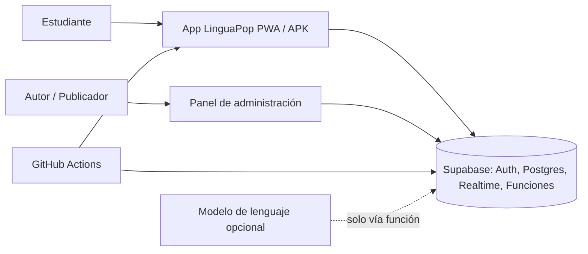

# LinguaPop – Diseño de solución y plan de migración

Este documento amplía la arquitectura base (`architecture-linguapop-plataforma.md`). La base fija las reglas (AD-1 a AD-16); aquí se explica cómo encajan las piezas y en qué orden construirlas. Si algo aquí contradice una regla de la base, manda la base.

## 1. Punto de partida y objetivo

**Hoy:** una PWA en un solo archivo (`linguapop.html`, unas 1500 líneas de JavaScript). El contenido (unidades, ejercicios, diálogos de Nova) está en arreglos del código. Todo el estado vive en `localStorage`. No hay cuentas, la liga es simulada y la voz depende del navegador.

**Objetivo:**
- Una app React que sale como PWA y como APK Android desde un solo código.
- Contenido editable desde un panel, sin reinstalar la app.
- Cuentas con progreso sincronizado y una liga con personas reales.
- Reglas del juego aisladas y con pruebas automáticas.
- Presupuesto cero.

## 2. Vista de contexto

## 3. Contenedores y responsabilidades

| Contenedor | Responsabilidad | Reglas que lo gobiernan |
| --- | --- | --- |
| `packages/domain` | Motor de lección, motor de llamada, puntuación, racha, comparación de texto, pliegue de eventos, puertos | AD-1, AD-6, AD-12, AD-13 |
| `packages/content` | Esquemas Zod, contenido semilla en JSON, tipos compartidos | AD-3, AD-4, AD-5 |
| `apps/app` | Pantallas React, stores, adaptadores (Web, Capacitor, Supabase), raíz de composición | AD-2, AD-10, AD-11 |
| `apps/admin` | Edición de borradores, vista previa, publicación | AD-3, AD-4, AD-8 |
| `supabase/` | Migraciones, políticas RLS, funciones (validar XP, liga, Nova) | AD-7, AD-8, AD-9, AD-14 |

## 4. Modelo de datos (esbozo)

El código es dueño del detalle final; esto fija las entidades.

| Tabla | Campos principales | Notas |
| --- | --- | --- |
| `profiles` | `id` (igual al usuario de Auth), `display_name`, `role`, `timezone`, `plan` | Rol: `student`, `author`, `publisher`. |
| `content_drafts` | `id`, `kind`, `slug`, `body` (JSON), `updated_by`, `updated_at` | Solo autores y publicadores. |
| `content_versions` | `version`, `schema_version`, `snapshot` (JSON), `published_by`, `published_at` | Inmutable. |
| `content_pointer` | `schema_version`, `version` | Un puntero `latest` por versión de esquema. |
| `progress_events` | `id` (UUID del cliente), `user_id`, `type`, `payload`, `occurred_at`, `content_version`, `status` | `status`: `accepted` o `rejected`. |
| `league_cohorts` | `id`, `week_start` | Semana en UTC, de lunes a lunes. |
| `league_members` | `cohort_id`, `user_id` (nulo si es bot), `bot_name`, `is_bot`, `weekly_xp` | Solo lo actualizan funciones. |
| `league_standings` (vista) | `cohort_id`, `display_name`, `weekly_xp`, `is_bot` | Única lectura entre usuarios. |

## 5. Flujos clave

**Publicar contenido (AD-4).** El autor guarda borradores y los prueba con la vista previa (que usa el mismo motor de lección). El publicador pulsa "Publicar": la función valida todo el snapshot con Zod, crea la versión nueva e inmutable y mueve el puntero. Las apps lo descargan la próxima vez que abran.

**Completar una lección (AD-6, AD-7).**
1. El motor de lección emite eventos y la app los aplica al instante al estado local.
2. Cada evento entra al outbox con su UUID.
3. Con red, se envían a Supabase; el servidor ignora ids repetidos, valida el tope de XP y acepta o rechaza.
4. Un evento rechazado se marca y sale del pliegue local.
5. La liga se actualiza en el servidor y llega por Realtime.

**Llamada con Nova (AD-9, AD-11, AD-12).** El motor de llamada (máquina de estados del dominio) pide "hablar" y "escuchar" al puerto `Speech`. Si falta el reconocimiento, el motor pasa a texto. Con el modo de IA activo, el puerto `DialogueAgent` llama a la función `nova`, que guarda la clave y limita el uso por usuario.

**Primer uso y migración local (AD-15).** Al primer inicio de sesión, la app convierte el progreso heredado de `localStorage` en eventos marcados `legacy` y los sube bajo la cuenta.

## 6. Seguridad y privacidad

- El rol vive en la base de datos y lo hacen cumplir las políticas RLS, no la interfaz (AD-8).
- Los clientes solo llevan la URL de Supabase y la clave anónima; la clave de servicio nunca sale del servidor (AD-9).
- De otros usuarios solo se ve nombre visible y XP semanal.
- Cada persona puede pedir el borrado de su cuenta y sus datos.
- Los exportes de respaldo se cifran antes de subirse (AD-14).

## 7. Entornos y operación

| Entorno | Qué es | Dónde |
| --- | --- | --- |
| `dev` | Supabase local con la CLI, web con Vite | Tu máquina |
| `staging` | Proyecto Supabase gratis nº 1, web de pruebas | Supabase + Cloudflare Pages o GitHub Pages |
| `prod` | Proyecto Supabase gratis nº 2, web pública | Igual que staging |

- **Plan gratis de Supabase:** los proyectos se pausan tras 7 días sin actividad y no incluyen copias automáticas. Los flujos programados de AD-14 cubren ambos puntos.
- **APK:** se compila en GitHub Actions desde una etiqueta git; el firmado usa un keystore guardado como secreto.
- **Preparar tu máquina:** actualizar Node a la versión 24 LTS y usar pnpm. El Android SDK local es opcional, porque el APK sale de la nube.

## 8. Plan de migración por fases

Estrategia estrangulada (AD-15): `linguapop.html` sigue funcionando hasta que la app nueva alcance paridad. El riesgo más alto es la voz en Android, así que se comprueba pronto.

| Fase | Entrega | Criterio de salida |
| --- | --- | --- |
| 0. Cimientos | Monorepo pnpm, Node 24, reglas de imports (AD-1, AD-2), CI mínima, tres proyectos Supabase | CI verde con un paquete vacío |
| 1. Dominio y contenido | Semilla JSON extraída de los arreglos, esquemas Zod, motores de lección y llamada, comparación de texto, racha, con pruebas Vitest | Todo el contenido semilla valida; pruebas del dominio en verde |
| 2. App web | Pantallas React (aprender, practicar, ligas simuladas locales, perfil, lección, llamada), adaptadores Web, LocalStore, PWA | Paridad funcional con `linguapop.html` en las pantallas y modos existentes |
| 3. Android temprano | Capacitor, adaptador `Speech` nativo, APK de depuración por CI | Una lección con "Escuchar" y "Hablar" funciona en un celular real |
| 4. Backend y cuentas | Migraciones, Auth, RLS, `ProgressSink` y outbox, lectura de contenido remoto, importación `legacy` | Dos dispositivos con la misma cuenta ven el mismo progreso |
| 5. Administración | Panel, roles, borradores, vista previa, publicación y puntero | Un cambio publicado llega a la app sin reinstalar |
| 6. Liga real | Cohortes, bots marcados, función de tope de XP, Realtime | Dos usuarios reales aparecen en la misma tabla semanal |
| 7. Endurecer | `nova` con IA opcional, exportes cifrados, ping programado, APK firmado | Ejercicio de restauración de respaldo y APK de versión instalado |

Cuando las fases 2 y 3 cumplan su criterio, se retira `linguapop.html`.

## 9. Riesgos y mitigaciones

| Riesgo | Mitigación |
| --- | --- |
| La voz nativa falla o es inconsistente en Android | Fase 3 temprana; AD-11 garantiza que toda ruta tenga salida sin voz |
| Límites o cambios del plan gratis de Supabase | Ping y exportes programados; el esquema está en migraciones, así que se puede mudar a otro Postgres |
| Contenido inválido o incompatible con apps viejas | Esquema único (AD-3), evolución solo aditiva y puntero por `schema_version` |
| Pocos usuarios para una liga viva | Bots marcados rellenan las cohortes (AD-7) |
| Versiones de la pila que cambian | Lockfile y `npm view` al crear el proyecto; las líneas mayores están en la base |

## 10. Qué se pospone

Está en la sección *Deferred* de la arquitectura base: analítica, notificaciones, iOS, publicación en Google Play, cobro del plan PRO, moderación de nombres, proveedor del modelo de lenguaje, antifraude avanzado, localización a otros idiomas, observabilidad y restauración de respaldos.
